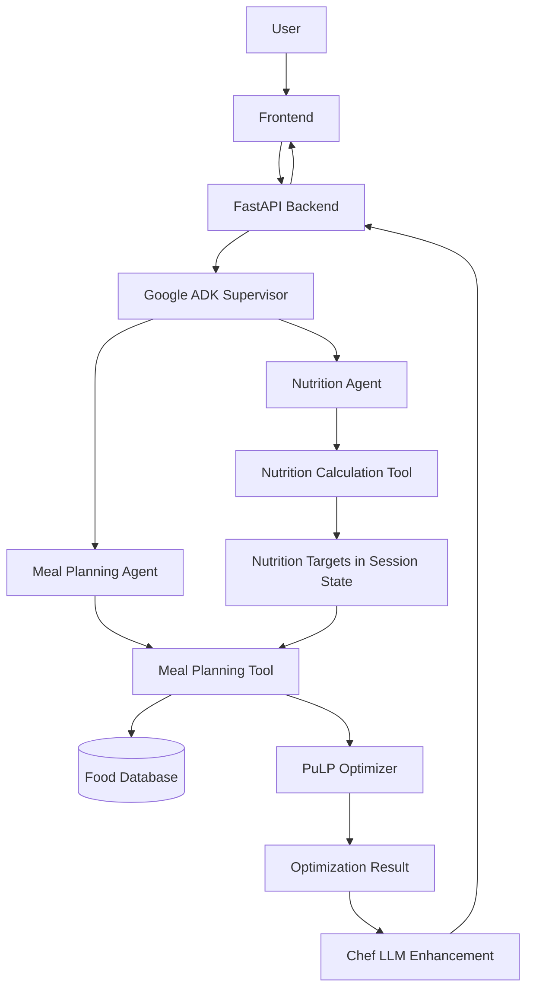

# NutriBudget 🥗

**AI-powered nutrition planning that fits your budget.**

NutriBudget is an AI-powered nutrition and meal-planning application designed to help students and budget-conscious users build meal plans around their nutritional goals, dietary preferences, and financial constraints.

Instead of relying on a chatbot to generate meals without verification, NutriBudget combines **AI agents, deterministic nutrition calculations, and mathematical optimization** to produce budget-aware meal plans.

## 🎯 The Problem

Maintaining a balanced diet can be challenging for students and people with limited budgets. Existing approaches often require users to track nutrition manually, calculate their own macronutrient requirements, or use separate tools to plan meals.

NutriBudget aims to simplify this process by bringing nutrition analysis, budget management, and meal planning into one application.

## ✨ Key Features

- **Personalized Nutrition Targets** — Calculate BMI, BMR, TDEE, and daily macronutrient targets based on user-provided body metrics, activity level, and goals.
- **Budget-Aware Meal Planning** — Generate meal plans within a specified budget while considering nutritional requirements.
- **Dietary Constraints** — Account for food exclusions and allergen restrictions during meal planning.
- **AI-Powered Meal Enhancement** — Use an LLM-based Chef component to improve how optimized meal plans are composed and presented.
- **Constraint-Based Optimization** — Use PuLP to solve the meal-planning problem rather than relying solely on unconstrained LLM generation.
- **Multi-Agent Orchestration** — Separate nutrition analysis and meal planning responsibilities into specialized agents.

## 🏗️ System Architecture

NutriBudget combines an LLM-based orchestration layer with deterministic computation and mathematical optimization.



### Core Components

| Component | Responsibility |
|---|---|
| FastAPI | Exposes API endpoints and coordinates backend requests |
| Google ADK Supervisor | Routes requests to the appropriate specialized agent |
| Nutrition Agent | Invokes deterministic nutrition calculations |
| Meal Planning Agent | Coordinates meal generation and attempts result-driven adjustments |
| Nutrition Engine | Calculates BMI, BMR, TDEE, and macronutrient targets |
| Food Database | Provides food information for meal planning |
| PuLP Optimizer | Searches for meal combinations that satisfy modeled constraints |
| Chef Component | Uses an LLM to enhance the composition and presentation of meals |
| Session State | Shares intermediate data, such as nutrition targets, across steps in a session |

## 🔄 How It Works

### 1. Nutrition Analysis

The user submits body metrics, activity level, and a fitness goal.

The Nutrition Agent calls a deterministic calculation tool to obtain nutritional targets. Numeric calculations are handled by application code rather than being left to the LLM to estimate.

The resulting targets are stored in the ADK session state for subsequent processing.

### 2. Meal Planning

The user specifies a budget and applicable dietary restrictions.

The Meal Planning Agent invokes the meal-planning tool, which retrieves available food data, applies supported filters, and passes the resulting inputs to the optimizer.

### 3. Constraint-Based Optimization

PuLP models the meal-planning problem using nutritional targets, food costs, and the constraints implemented by the application.

The optimizer returns a feasible solution when one can be found under the modeled constraints. Otherwise, it reports that the problem is infeasible.

### 4. AI-Assisted Meal Enhancement

When a feasible plan is available, the Chef component uses an LLM to enhance the meal composition and presentation.

The optimizer remains responsible for the mathematical solution; the LLM is not the source of truth for nutritional calculations or constraint satisfaction.

### 5. Response and Error Handling

The backend returns the result to the frontend. The implementation also includes fallback logic for meal planning when the agent execution path fails or does not produce a usable result.

Fallback execution does not guarantee that a feasible plan exists.

## 🧠 Why Multi-Agent AI?

A conventional pipeline can execute nutrition calculations, query a database, run an optimizer, and format the result. In fact, a pipeline is often simpler and more predictable when every step is fixed.

NutriBudget uses an agent-based architecture to support natural-language interaction and flexible tool orchestration.

The design separates responsibilities:

- **LLM agents:** Interpret requests, select tools, coordinate processing, and explain outcomes.
- **Deterministic functions:** Calculate nutrition targets.
- **Mathematical optimization:** Search for solutions that satisfy modeled constraints.
- **Backend fallback logic:** Provide an alternative execution path when agent-based processing fails.

This hybrid approach combines the flexibility of LLMs with more predictable numerical computation.

## 🛠️ Tech Stack

| Technology | Usage |
|---|---|
| Python | Backend logic and nutrition calculations |
| FastAPI | REST API |
| Google ADK | Agent creation, orchestration, and session management |
| Google Gemini | LLM-powered agent behavior and meal enhancement |
| PuLP | Constrained optimization |
| PostgreSQL | Relational data storage |
| Docker | Containerized development and deployment |
| React + Vite | Frontend, if enabled in the deployed project |

## 🔌 API Overview

The backend exposes the following endpoints:

| Method | Endpoint | Purpose |
|---|---|---|
| `GET` | `/health` | Check backend health |
| `GET` | `/health/db` | Check database connectivity |
| `POST` | `/api/v1/nutrition/macros` | Calculate personalized nutrition targets |
| `POST` | `/api/v1/meal-plan` | Generate a budget-aware meal plan |

For the exact request schemas, response formats, and validation rules, refer to the FastAPI interactive documentation at `/docs` while the backend is running.

## 🚀 Getting Started

### Prerequisites

- Python compatible with the project's pinned dependencies
- Docker and Docker Compose, if using the provided container setup
- PostgreSQL, either locally or through Docker
- A Google Gemini API key with access to a supported model

### Installation

1. Clone the repository:

   ```bash
   git clone <YOUR_REPOSITORY_URL>
   cd <YOUR_PROJECT_DIRECTORY>
   ```

2. Configure the environment variables required by the backend.

   Example placeholder configuration:

   ```dotenv
   GOOGLE_API_KEY=your_api_key
   DATABASE_URL=your_database_connection_string
   ```

   Check the project's configuration code for the exact variable names and required values before running the application.

3. Start the database and backend using the repository's configured development or Docker workflow.

4. Open the FastAPI documentation at:

   ```text
   http://localhost:<BACKEND_PORT>/docs
   ```

> **Note:** The repository-specific dependency installation commands, Docker Compose service names, ports, and frontend startup commands should be documented according to the actual project configuration.

## ⚠️ Current Limitations

- **In-memory sessions:** The current implementation uses `InMemorySessionService`. Session state is not durable across backend restarts.
- **Guest identity:** The current configuration uses a fixed `USER_ID = "guest"`. Production deployment requires proper user identity, authentication, and session access control.
- **Agent reliability:** LLM-driven retries and reflection depend on model behavior and are not guaranteed to execute as intended.
- **Optimization feasibility:** A meal plan may be infeasible when the budget, food availability, and nutritional constraints cannot be satisfied simultaneously.
- **Nutrition data quality:** Results depend on the quality, coverage, and accuracy of the underlying food data and cost information.
- **Health guidance:** Generated meal plans are intended for general nutrition planning, not as a replacement for professional medical or dietetic advice.

## 🔭 Future Improvements

- Persistent user profiles and meal-planning history
- Better handling of food preferences and ingredient substitutions
- More diverse meal plans with reduced repetition
- Improved feedback-driven evaluation of generated plans
- Stronger validation of nutritional constraints after meal enhancement
- More comprehensive testing for infeasible optimization cases
- Production-ready authentication, authorization, and session persistence

## 👥 Team

NutriBudget was developed collaboratively as part of an AI Agents project, bringing together product development, backend engineering, and AI-assisted meal planning.

**Team:** O Di O Le

## 🙏 Acknowledgments

Thanks to the mentors, supporters, and club community who provided guidance and feedback throughout the project.

---

*NutriBudget — Making personalized nutrition planning more accessible and budget-conscious.*
