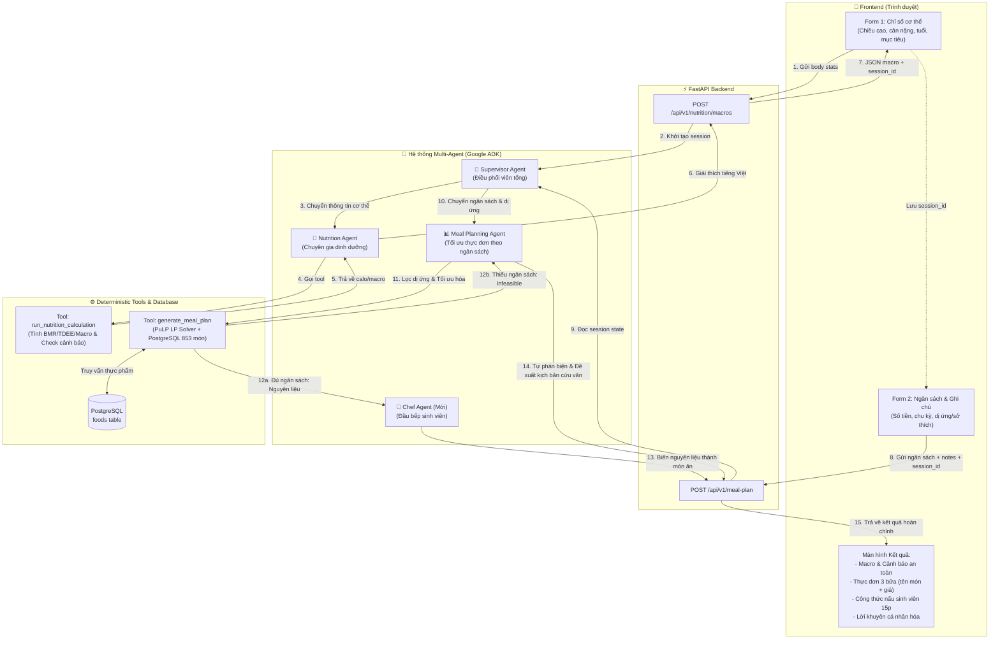

# Tài liệu Kiến trúc & Luồng hoạt động của AI Agents (NutriBudget)

> **Dành cho:** Toàn bộ thành viên đội dự án NutriBudget (Lead, Frontend, Data, QA, Tester)  

---

## 1. Triết lý thiết kế: Tại sao NutriBudget dùng AI Agent?

Trong một ứng dụng dinh dưỡng & ngân sách cho sinh viên, nếu chỉ dùng LLM thông thường (chat thuần túy), AI sẽ mắc lỗi **ảo giác (hallucination)**: tự bịa calo, cộng trừ sai tiền, hoặc gợi ý thực đơn không cân bằng.

Vì vậy, NutriBudget áp dụng kiến trúc **Neuro-Symbolic (Kết hợp AI + Thuật toán toán học)**:
- **Phần 'cứng' (Deterministic Code):** Công thức toán học (Mifflin-St Jeor) và Bộ giải quy hoạch tuyến tính (**Linear Programming - PuLP**) phụ trách tính toán BMR, TDEE, macro và tối ưu chi phí nguyên liệu. Đảm bảo **chính xác 100%**.
- **Phần 'mềm' (AI Agents - Google ADK):** Đóng vai trò bộ não tư duy linh hoạt: phân tích dị ứng/sở thích từ văn bản tự nhiên, điều phối công việc giữa các chuyên gia, tự thương lượng khi thiếu tiền, và giải thích món ăn dễ hiểu cho sinh viên.

---

## 2. Sơ đồ Luồng hoạt động Hệ thống (End-to-End Agent Flow)



---

## 3. Chi tiết các Agent trong Hệ thống

### 👑 1. Supervisor Agent (Điều phối viên)
- **Vai trò:** Tiếp nhận mọi tin nhắn từ người dùng, đọc hiểu mục đích và định tuyến chính xác tới Agent chuyên môn.
- **Quy tắc phân luồng:**
  - Tin nhắn chứa thông số cơ thể (chiều cao, cân nặng, tuổi, mục tiêu) $\rightarrow$ Chuyển cho **Nutrition Agent**.
  - Tin nhắn chứa ngân sách và yêu cầu bữa ăn $\rightarrow$ Chuyển cho **Meal Planning Agent**.
- **Nguyên tắc:** Supervisor không tự tính toán, không tự bịa số liệu.

---

### 🥗 2. Nutrition Agent (Chuyên gia Dinh dưỡng)
- **Nhiệm vụ:**
  1. Trích xuất chính xác 6 tham số: `weight_kg`, `height_cm`, `age`, `gender`, `activity_level`, `goal`.
  2. Gọi tool `run_nutrition_calculation` để tính BMR, TDEE, Calorie target và tỷ lệ Macro (Protein, Fat, Carbs).
  3. Ghi kết quả vào `session.state` để dùng cho Bước 2.
  4. Viết 2–4 câu tiếng Việt giải thích khoa học tại sao mục tiêu calo/macro này phù hợp, đồng thời nhấn mạnh cảnh báo an toàn nếu có (ví dụ: dưới 18 tuổi, BMI thấp, hoặc calo quá thấp).

---

### 📊 3. Meal Planning Agent (Kỹ sư Tối ưu Thực đơn)
- **Nhiệm vụ:**
  1. **Hiểu ngữ nghĩa dị ứng:** Đọc ghi chú người dùng (`notes`) và phân loại đúng vào 5 nhóm dị ứng chuẩn: `seafood`, `dairy`, `peanut`, `gluten`, `egg`. *Đặc biệt: Phân biệt được thích ăn vs dị ứng thật sự (ưu tiên an toàn).*
  2. Gọi tool `generate_meal_plan` với ngân sách và danh sách dị ứng.
  3. Tool sẽ gọi solver **PuLP Linear Programming** để quét 853 món ăn trong PostgreSQL và giải bài toán Diet Problem (đạt đủ calo ±10%, đủ đạm/béo/carb, có rau xanh ≥ 150g, tối thiểu chi phí).

#### 🔁 [Nâng cấp MVP 1] Vòng lặp Tự phản biện (Self-Correction & Autonomous Negotiation)
Khi ngân sách người dùng nhập vào **quá thấp** khiến bài toán vô nghiệm (`feasible = false`):
- **Cơ chế truyền thống:** Báo lỗi "Không đủ tiền".
- **Cơ chế Agentic của NutriBudget:**
  1. Agent tự chạy solver lần 2 (bỏ ràng buộc ngân sách) để tìm **mức chi phí sàn tối thiểu** cần có.
  2. Agent tự động xây dựng **2 kịch bản cứu vãn**:
     - **Kịch bản A (Tiết kiệm ngân sách):** Gợi ý thay thế các nguồn đạm đắt tiền bằng đạm bình dân (trứng, đậu phụ non) hoặc điều chỉnh nhẹ mục tiêu calo trong giới hạn an toàn.
     - **Kịch bản B (Đạt đúng mục tiêu):** Nêu rõ số tiền tối thiểu cần bổ sung thêm (ví dụ: *"Bạn chỉ cần thêm khoảng 18.000đ/ngày là có thể đạt đúng chuẩn tăng cơ"*).

---

### 🍳 4. Chef Agent (Đầu bếp Sinh viên - Nâng cấp MVP 2)
- **Vấn đề thực tế:** Solver toán học chỉ xuất ra danh sách nguyên liệu thô (ví dụ: *30g bột trứng, 83g củ súng, 37g măng tre khô*). Sinh viên nhìn vào sẽ không biết nấu món gì.
- **Nhiệm vụ của Chef Agent:**
  1. Nhận danh sách nguyên liệu thô từ Meal Planning Agent.
  2. **Biến thành món ăn Việt Nam hấp dẫn:**
     - *Bữa sáng:* Trứng bác ăn kèm cơm nóng & dưa góp.
     - *Bữa trưa:* Canh măng sườn/thịt bằm, rau cải xào tỏi.
     - *Bữa tối:* Đậu phụ sốt cà chua, canh rau ngót.
  3. **Mẹo nấu nhanh cho sinh viên:** Hướng dẫn cách nấu siêu tốc trong 15 phút, tận dụng nồi cơm điện hoặc chảo chống dính, không tốn nhiều gia vị cầu kỳ.

---

## 4. Quản lý Session State & Chống Ảo giác (Anti-Hallucination)

NutriBudget áp dụng mô hình **Stateless DB** (không bắt sinh viên tạo tài khoản, bảo vệ quyền riêng tư) kết hợp **Session State ADK**:

1. **Truyền dữ liệu qua State (Không qua Prompt text):**
   - Số liệu BMR, calo, macro tính ở Bước 1 được tool lưu trực tiếp vào `tool_context.state["macro_targets"]`.
   - Sang Bước 2, Meal Planning Agent đọc trực tiếp từ State này, **không yêu cầu người dùng nhập lại** và **không để LLM truyền miệng** (tránh sai lệch số liệu).
2. **Đối chiếu tham số nghiêm ngặt (Route Guardrails):**
   - Trong `main.py`, backend luôn đối chiếu dữ liệu người dùng gửi lên với tham số mà Agent đưa vào tool (`used vs expected`).
   - Nếu LLM tự ý biến đổi số liệu (ví dụ: cân nặng 65kg bị chép thành 70kg), hệ thống lập tức chặn lại và báo lỗi.

---

## 5. Hướng dẫn Tích hợp dành cho Bạn 1 & Bạn 2 (Frontend)

Cả hai bạn làm Frontend chỉ cần nắm vững hợp đồng API (API Contract) 2 bước sau:

### 🔹 Bước 1: Gọi tính Macro (Form 1 - Bạn 1)
- **Endpoint:** `POST http://localhost:8000/api/v1/nutrition/macros`
- **Request Body (JSON):**
  ```json
  {
    "height_cm": 172.0,
    "weight_kg": 68.0,
    "age": 21,
    "gender": "male",
    "activity_level": "moderate",
    "goal": "muscle_gain",
    "notes": "Muốn tập gym tăng cơ"
  }
  ```
- **Response JSON:**
  ```json
  {
    "session_id": "59d11ae4-3bcb-458f-a386-3fd96b87c8db",
    "calories": 2740.8,
    "protein_g": 130.0,
    "fat_g": 76.1,
    "carb_g": 383.9,
    "explanation": "Với mục tiêu tăng cơ, mức calo 2740.8 kcal giúp...",
    "warning": null
  }
  ```
- **Lưu ý quan trọng cho Bạn 1:** Phải lưu chuỗi `session_id` này vào biến toàn cục hoặc `sessionStorage` trong trình duyệt để chuyển sang Form 2!

---

### 🔹 Bước 2: Gọi lập Thực đơn (Form 2 & Render - Bạn 2)
- **Endpoint:** `POST http://localhost:8000/api/v1/meal-plan`
- **Request Body (JSON):**
  ```json
  {
    "session_id": "59d11ae4-3bcb-458f-a386-3fd96b87c8db",
    "budget": {
      "amount": 500000,
      "period": "weekly"
    },
    "notes": "Tôi bị dị ứng hải sản và không thích ăn cay"
  }
  ```
- **Response JSON (Trường hợp Khả thi):**
  ```json
  {
    "feasible": true,
    "meals": [
      {
        "meal_name": "Bữa sáng",
        "meal_cost": 15000,
        "macros": { "calories": 685, "protein_g": 32, "fat_g": 19, "carb_g": 96 },
        "ingredients": [
          { "name": "Trứng gà", "amount_g": 100, "cost": 7000 },
          { "name": "Bánh mì", "amount_g": 80, "cost": 8000 }
        ]
      },
      { "meal_name": "Bữa trưa", "meal_cost": 25000, "...": "..." },
      { "meal_name": "Bữa tối", "meal_cost": 22000, "...": "..." }
    ],
    "total_cost_estimate": 434000,
    "message": null,
    "suggested_budget": null
  }
  ```
- **Response JSON (Trường hợp Thiếu ngân sách):**
  ```json
  {
    "feasible": false,
    "meals": [],
    "total_cost_estimate": null,
    "message": "Với ngân sách hiện tại chưa đủ đạt mục tiêu dinh dưỡng. Cần tối thiểu khoảng 480.000đ/tuần...",
    "suggested_budget": 480000
  }
  ```
- **Lưu ý cho Bạn 2 khi render:**
  - Nếu `feasible === true`: Render danh sách 3 thẻ bữa ăn, hiển thị thanh tiến độ Calo/Protein và tổng tiền ước tính.
  - Nếu `feasible === false`: Hiển thị khung cảnh báo màu vàng kèm nút bấm: *"Tự động cập nhật ngân sách lên {suggested_budget}đ"* để người dùng ấn 1 chạm là giải quyết xong!

---

## 6. Gợi ý Điểm cộng khi Thuyết trình (Demo Hackathon)

1. **Mở tab kiểm tra Database:** Cho BGK xem bảng `foods` có hơn 850 món ăn Việt Nam thật và câu truy vấn mảng dị ứng `GIN index` cực nhanh.
2. **Chiếu Luồng suy nghĩ của Agent (Agent Trace):** Khi bấm nút Tính toán, giao diện hiển thị các bước Agent đang chạy:
   - `[Supervisor]` *Phân tích yêu cầu và chuyển giao cho Chuyên gia dinh dưỡng...*
   - `[Nutrition Agent]` *Tính toán chỉ số năng lượng: 2.740 kcal...*
   - `[Meal Planner]` *Quét dị ứng... Giải bài toán quy hoạch tuyến tính trên 853 món...*
   - `[Chef Agent]` *Đang thiết kế món ăn sinh viên dễ nấu trong 15 phút...*
3. **Thử nghiệm ca khó:** 
   - Nhập ngân sách 50.000đ/tháng (cực thấp) $\rightarrow$ Xem Agent tự phản biện và đề xuất phương án giải cứu.
   - Nhập dị ứng hải sản và sữa $\rightarrow$ Cho thấy thực đơn hoàn toàn sạch các chất gây dị ứng.
