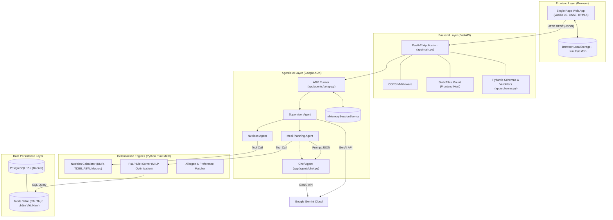
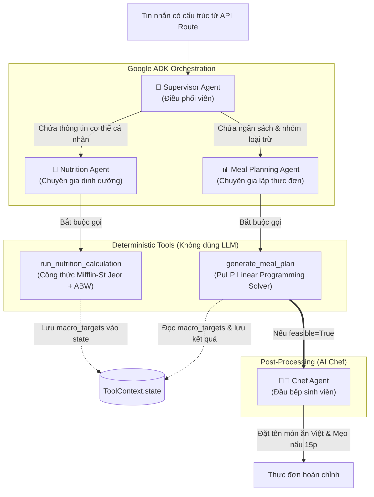
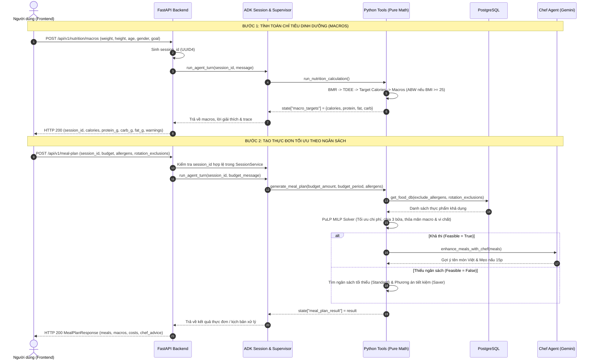

# NutriBudget — (System Architecture & Technical Specifications)

> [!NOTE]
> NutriBudget là giải pháp tối ưu hóa dinh dưỡng và chi phí sinh hoạt dành cho sinh viên Việt Nam, kết hợp giữa mô hình **Deterministic Algorithms** (Công thức dinh dưỡng y khoa chuẩn & Quy hoạch tuyến tính PuLP) và **AI Agents** (Google Agent Development Kit - ADK & Gemini Models).

---

## 1. System Architecture (Kiến trúc Hệ thống)

NutriBudget áp dụng mô hình phân lớp rõ ràng (**Layered Architecture**), phân tách giữa tầng giao diện người dùng, tầng dịch vụ API/Agent điều phối, tầng thuật toán tính toán định lượng (deterministic engines) và tầng cơ sở dữ liệu.



---

## 2. Agent Architecture (Kiến trúc Agent ADK & Tool Calling)

Hệ thống triển khai mô hình **Hierarchical Multi-Agent** (Đa tác tử phân cấp) thông qua **Google ADK (Agent Development Kit)**:



### Các Agent trong hệ thống:
1. **Supervisor Agent (`supervisor`):**
   * **Nhiệm vụ:** Phân tích nội dung tin nhắn để chuyển tiếp cho Sub-agent chuyên trách:
     * Dữ liệu sinh trắc (chiều cao, cân nặng, tuổi, mục tiêu) $\rightarrow$ `nutrition_agent`.
     * Dữ liệu tài chính & dị ứng (ngân sách tuần/tháng, dị ứng) $\rightarrow$ `meal_planning_agent`.
   * **Nguyên tắc an toàn:** Không tự trả lời kiến thức chuyên môn hoặc tự chế số liệu, luôn ủy quyền cho agent con.
2. **Nutrition Agent (`nutrition_agent`):**
   * **Nhiệm vụ:** Tiếp nhận thông số từ người dùng, gọi tool `run_nutrition_calculation`. Sau đó diễn giải kết quả $2\text{ – }4$ câu tiếng Việt ngắn gọn, dễ hiểu.
3. **Meal Planning Agent (`meal_planning_agent`):**
   * **Nhiệm vụ:** Nhận ngân sách và danh sách nhóm dị ứng đã chọn, gọi tool `generate_meal_plan` tương tác với solver quy hoạch tuyến tính.
4. **Chef Agent (`chef.py`):**
   * **Nhiệm vụ:** Đóng vai trò đầu bếp sinh viên Việt Nam am hiểu điều kiện phòng trọ. Nhận giỏ nguyên liệu thô từ solver (ví dụ: $200\text{g}$ thịt gà, $100\text{g}$ rau ngót) để biến thành **tên món ăn quen thuộc** (ví dụ: *Thịt gà luộc chấm muối tiêu chanh, Canh rau ngót*) và **mẹo nấu nhanh 10–15 phút**.

---

## 3. End-to-End Flow & Vòng đời Session State (Session Lifecycle)

Toàn bộ phiên làm việc của người dùng được theo dõi xuyên suốt qua 2 bước lớn nhờ `InMemorySessionService` của ADK.



### Chi tiết thay đổi của `SessionState`:
```text
[Khởi tạo Bước 1]
  │
  ├──> ToolContext.state["nutrition_inputs"] = { weight_kg, height_cm, age, gender, activity_level, goal }
  ├──> ToolContext.state["macro_targets"] = { calories: 1583, protein_g: 118.8, fat_g: 43.7, carb_g: 178 }
  └──> ToolContext.state["warnings"] = [...]
  │
[Chuyển tiếp sang Bước 2 (Giữ nguyên session_id)]
  │
  ├──> session.state["meal_plan_requested_allergens"] = ["seafood", "peanut"]
  ├──> session.state["meal_plan_rotation_exclusions"] = ["Cơm trắng", "Thịt lợn nạc"]
  ├──> session.state["meal_plan_budget"] = { amount: 500000, period: "weekly" }
  ├──> session.state["meal_plan_filters"] = { allergens: [...], rotation_exclusions: [...] }
  └──> session.state["meal_plan_result"] = { feasible: true, meals: [...], total_cost_estimate: 482000 }
```

---

## 4. Tương tác Frontend — Backend — Database

| Thành phần | Giao thức / Cơ chế | Dữ liệu trao đổi | Nhiệm vụ chính |
| :--- | :--- | :--- | :--- |
| **Frontend $\leftrightarrow$ Backend** | HTTP RESTful API (JSON), Async `fetch` | Request Body & Response Models | * Gửi thông tin cá nhân (Form 1)<br/>* Gửi ngân sách, dị ứng, đổi thực đơn (Form 2)<br/>* Nhận chỉ tiêu dinh dưỡng, thực đơn, lời khuyên đầu bếp |
| **Backend $\leftrightarrow$ Database** | PostgreSQL Driver (`psycopg2`), Connection Pooling | SQL Queries (`SELECT` có bộ lọc tags) | * Truy vấn danh mục 83+ món ăn Việt Nam (`foods`)<br/>* Lọc tức thì theo các mảng `allergen_tags` và `meal_types` |
| **Backend $\leftrightarrow$ ADK Engine** | In-Process Python Async Calls | ADK Event Stream, `types.Content` | * Điều phối vòng lặp Agentic (Supervisor $\rightarrow$ Sub-agents)<br/>* Lưu vết thực thi có kiểm chứng (`agent_trace`) |
| **Agent $\leftrightarrow$ Gemini Cloud** | Google GenAI SDK (gRPC / HTTPS) | Prompt có cấu trúc, Function Call, JSON Mode | * Sinh diễn giải dinh dưỡng cá nhân hóa<br/>* Đặt tên món ăn thân thuộc và mẹo chế biến sinh viên |
| **Frontend $\leftrightarrow$ LocalStorage** | Browser Storage API | JSON Object (`nutribudget_saved`) | * Lưu trữ các thực đơn ưng ý offline ngay trên trình duyệt mà không cần đăng nhập |

---

## 5. Danh mục Thư viện & Vai trò ứng dụng

### Backend & AI Stack:
* **`fastapi` (0.110.0):** Web framework hiện đại hiệu năng cao, cung cấp OpenAPI schema tự động (`/docs`) và async routing.
* **`uvicorn[standard]` (0.27.0):** ASGI Web Server chạy ứng dụng FastAPI đa luồng.
* **`pydantic` (2.6.0):** Kiểm thực chặt chẽ dữ liệu đầu vào (Input validation) và serialize phản hồi (Response models). Ngăn chặn dữ liệu dị ứng/ghi chú mâu thuẫn nhờ `@model_validator`.
* **`google-adk` (2.11.0):** Thư viện cốt lõi định nghĩa Agent, Runner, ToolContext và quản lý đa phiên (`InMemorySessionService`).
* **`google-genai` (0.4.0):** SDK tương tác trực tiếp với các mô hình Gemini (`gemini-3.5-flash-lite`, `gemini-3.8-flash`) với cơ chế tự động chuyển vùng fallback (`model_fallback.py`) khi gặp lỗi 429/5xx.
* **`pulp` (2.8.0):** Thư viện giải bài toán Quy hoạch Tuyến tính nguyên tương đương (MILP - Mixed Integer Linear Programming). Đóng vai trò hạt nhân của bài toán **Diet Problem**: cực tiểu hóa chi phí nhưng bắt buộc thỏa mãn chặn trên/dưới của calo, đạm, béo, tinh bột, chất xơ và cân đối 3 bữa ăn.
* **`psycopg2-binary` (2.9.9):** Driver kết nối C-level tối ưu giữa Python và PostgreSQL.
* **`python-dotenv` (1.0.1):** Nạp biến môi trường (`GOOGLE_API_KEY`, `DATABASE_URL`) an toàn từ file `.env`.

### Database Stack:
* **`PostgreSQL 15+`:** Cơ sở dữ liệu quan hệ, sử dụng các kiểu dữ liệu nâng cao như `ARRAY` và `VARCHAR[]` để lọc dị ứng (`allergen_tags`) và bữa ăn (`meal_types`) với tốc độ mili-giây.

### Frontend Stack:
* **`Vanilla JavaScript (ES6+)`:** Không dùng framework nặng (React/Vue) nhằm đạt tốc độ tải trang dưới 50ms, tương thích tối đa với mọi thiết bị di động sinh viên.
* **`CSS3 Flexbox & Grid`:** Giao diện Responsive hiện đại, tối ưu cho trải nghiệm người dùng cả trên desktop lẫn điện thoại.

---

## 6. Cơ chế Bền bỉ (Resilience & Fallback Strategy)

1. **Chống lỗi LLM khi đổi thực đơn:** Nếu LLM không gọi tool `generate_meal_plan` ở lượt 2, backend tự động chuyển quyền sang `_fallback_meal_plan` để chạy trực tiếp solver quy hoạch tuyến tính deterministic, đảm bảo **không bao giờ trả về lỗi 500**.
2. **Khóa tỷ lệ bữa ăn cân bằng:** Ràng buộc `MEAL_SPLIT` được thực thi ở cả chế độ nghiêm ngặt và dự phòng, ngăn chặn hoàn toàn tình trạng bữa 0 calo hoặc dồn calo vào một bữa.
3. **An toàn dinh dưỡng cho BMI cao:** Áp dụng công thức Cân nặng hiệu chỉnh (ABW), bảo vệ sức khỏe người dùng thừa cân, đồng thời mở rộng không gian nghiệm để solver luôn tìm ra thực đơn phù hợp với mọi ngân sách.
